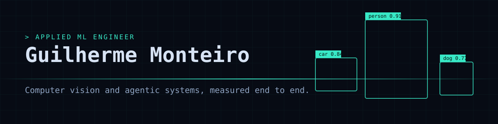

**I turn client problems into measured computer-vision and agentic systems.**

[Portfolio](https://guilherme-r-monteiro.github.io) · [LinkedIn](https://www.linkedin.com/in/grmonteiro) · [Email](mailto:guilhermeromonteiro@gmail.com)

## About

I am an applied ML engineer who works close to the client. At ALTAVE I was Forward Deployed Engineer for a drilling client, I manage a maritime monitoring project, and I led the architecture of a real-time GPU vision pipeline. I like to own a product end to end, from Figma and frontend to backend, AI models and hardware installation. Today I focus on agentic systems and computer vision.

Based in Santos, São Paulo, Brazil (remote). Portuguese (native), English (native or bilingual). Mechatronics Engineering, Escola Politécnica da USP.

## Experience

- **ALTAVE** (Jun 2024 - present): Applied ML Engineer. Forward Deployed Engineer for NABORS (drilling), Project Manager for SATORO (maritime), architecture of a real-time GPU vision pipeline.
- **Freelance backend engineer** (2026): electoral-analytics platform on FastAPI, PostgreSQL and GCP.
- **Braskem** (2022 - 2024): Product Analyst and People Analytics Intern.
- **Digital Social and Kinea Investimentos** (2021 - 2023): business intelligence and investor relations.

## Projects

| Project | Result | Stack |
|---|---|---|
| [vision-agent-mcp](https://github.com/guilherme-r-monteiro/vision-agent-mcp) | 26/36 to 28/36 on an agent evaluation after one tool-description change | MCP, Python, ONNX Runtime |
| [helper-bot](https://github.com/guilherme-r-monteiro/helper-bot) | AlphaZero-style KeyForge agent, 13 architecture decision records | PyTorch, ONNX, Node.js |
| [agent-retrieval-service](https://github.com/guilherme-r-monteiro/agent-retrieval-service) | nDCG@10 0.688 with hybrid retrieval | FastAPI, SSE, Terraform |
| [lidar-camera-fusion](https://github.com/guilherme-r-monteiro/lidar-camera-fusion) | 0.35 m median distance error against 2.45 m for camera only | KITTI, sensor fusion |
| [cv-label-audit](https://github.com/guilherme-r-monteiro/cv-label-audit) | 89% of injected label errors found | YOLOv8, SQLite |
| [cv-training-lab](https://github.com/guilherme-r-monteiro/cv-training-lab) | 90.4% CIFAR-10 test accuracy | PyTorch, Grad-CAM |
| [edge-inference-bench](https://github.com/guilherme-r-monteiro/edge-inference-bench) | 266 tok/s on GPU, 78 on CPU | C++, llama.cpp, CUDA |
| [ml-feature-serving](https://github.com/guilherme-r-monteiro/ml-feature-serving) | AUC 0.72 with honest features, 0.94 when they leak | FastAPI, feature store |

## Stack

`Python` `PyTorch` `TensorRT` `DeepStream` `ONNX` `YOLOv8` `OpenCV` `CUDA` `FastAPI` `gRPC` `asyncio` `TypeScript` `Figma` `Docker` `AWS` `MLflow`
